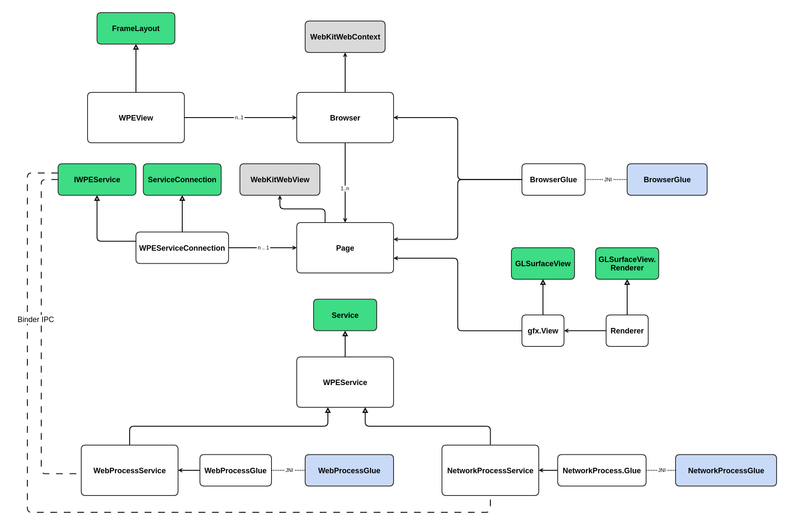
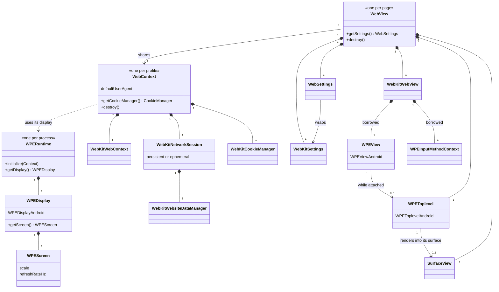
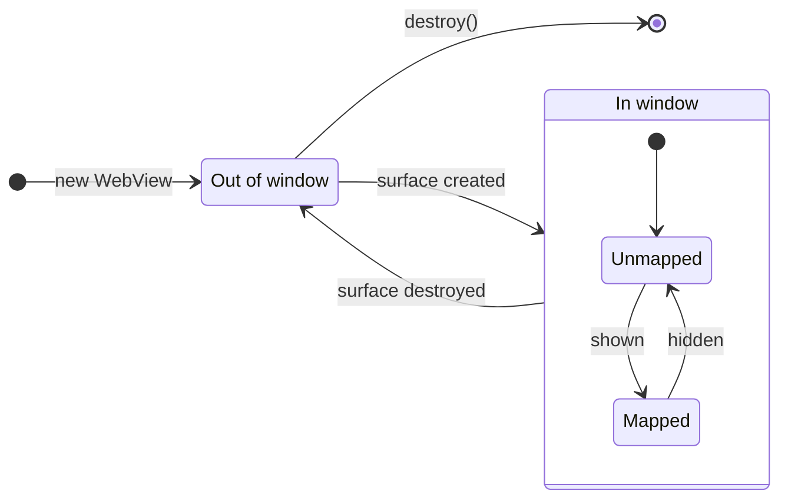

# Android API Architecture

This document describes the current Android API split after the WPEPlatform
backend, JNI/CAPI bridge, and high-level convenience API changes.

Older documentation and examples may still refer to the pre-refactor API path
(`org.wpewebkit.wpeview.WPEView`, `WPEContext`, the `org.wpewebkit.wpe.WK*`
proxies, or Browser/Page/gfx.View internals). Those classes have been removed;
new and existing code should use the APIs described below.



## Layers

### Layer 0: Runtime and process infrastructure

This layer initializes native libraries, bridges Android and GLib event
delivery, and manages the Android services used for auxiliary processes on
behalf of the WPEPlatform process manager.

Java code lives in:

- `wpeview/src/main/java/org/wpewebkit/WPEApplication.java`
- `wpeview/src/main/java/org/wpewebkit/wpe/WPERuntime.java`
- `wpeview/src/main/java/org/wpewebkit/wpe/WPEActivityObserver.java`
- `wpeview/src/main/java/org/wpewebkit/wpe/AuxiliaryProcessesContainer.java`
- `wpeview/src/main/java/org/wpewebkit/wpe/services/`

Native code lives in:

- `wpeview/src/main/cpp/Runtime/EntryPoint.cpp`
- `wpeview/src/main/cpp/Runtime/WPERuntime.cpp`
- `wpeview/src/main/cpp/Runtime/MessagePump.cpp`
- `wpeview/src/main/cpp/Common/`

`Runtime/EntryPoint.cpp` is the JNI entry point. It initializes the common JNI
environment, registers the `WPERuntime` infrastructure JNI mappings, then
registers the `capi/` mappings through `WebKit::configureJNIMappings()`.

### Layer 1: Public Android convenience API

This is the Android widget API intended for application developers. It owns the
Android UI behavior: `SurfaceView` lifecycle, physical-to-logical coordinate
translation, adaptation of touch and key events, and delivery to WebView-style
clients.

Java code lives in:

- `wpeview/src/main/java/org/wpewebkit/wpeview/WebView.java`
- `wpeview/src/main/java/org/wpewebkit/wpeview/WebContext.java`
- `wpeview/src/main/java/org/wpewebkit/wpeview/WebSettings.java`
- `wpeview/src/main/java/org/wpewebkit/wpeview/CookieManager.java`
- `wpeview/src/main/java/org/wpewebkit/wpeview/WebViewClient.java`
- `wpeview/src/main/java/org/wpewebkit/wpeview/WebChromeClient.java`

Use this layer when embedding WPE in a normal Android view hierarchy:

```xml
<org.wpewebkit.wpeview.WebView
    android:id="@+id/web_view"
    android:layout_width="match_parent"
    android:layout_height="match_parent" />
```

```java
WebView webView = findViewById(R.id.web_view);
webView.setWebViewClient(new WebViewClient());
webView.setWebChromeClient(new WebChromeClient());
webView.loadUrl("https://www.wpewebkit.org/");
```

`WebView` creates a `WebContext` by default. Applications that want to share
engine state, cookies, cache directories, or automation mode between multiple
views should create one `WebContext` and pass it to each `WebView`. Each
`WebView` still has its own settings, which start from the defaults of its
`WebContext`. Pass an Activity as the UI context, which JavaScript dialogs and
the soft keyboard need.

```java
WebContext context = new WebContext(applicationContext);
WebView first = new WebView(activity, context);
WebView second = new WebView(activity, context);
```

See [Object Model](#object-model) and [WebView Lifecycle](#webview-lifecycle)
for what these objects hold and how a `WebView` follows the Android view
lifecycle.

### Layer 2: Low-level Java JNI/CAPI bridge

This layer exposes Java proxy objects for WebKit and WPEPlatform native objects.
It is intended for advanced embedders who want to manage the WPE objects
directly instead of using the Android `WebView` convenience widget.

Java code lives in `wpeview/src/main/java/org/wpewebkit/wpe/`:

- `WebKitWebView` wraps a native `WebKitWebView`.
- `WebKitWebContext` wraps a native `WebKitWebContext`.
- `WebKitNetworkSession` wraps a native `WebKitNetworkSession`.
- `WebKitWebsiteDataManager` wraps a native `WebKitWebsiteDataManager`.
- `WebKitCookieManager` wraps a native `WebKitCookieManager`.
- `WebKitSettings` wraps a native `WebKitSettings`.
- `WPEDisplay` wraps a native `WPEDisplay`.
- `WPEInputMethodContext` wraps a native `WPEInputMethodContext` borrowed from a `WPEView`.
- `WPEScreen` wraps a native `WPEScreen`.
- `WPEToplevel` wraps a native `WPEToplevel`.
- `WPEView` wraps a native `WPEView`.
- `MainLooperDispatcher` adapts callbacks to the Android main looper.

Native bridge code lives in `wpeview/src/main/cpp/capi/`. File names mirror the
Java proxy names and the native types they expose:

- `WebKitWebView.cpp`
- `WebKitWebContext.cpp`
- `WebKitNetworkSession.cpp`
- `WebKitWebsiteDataManager.cpp`
- `WebKitCookieManager.cpp`
- `WebKitSettings.cpp`
- `WPEDisplay.cpp`
- `WPEInputMethodContext.cpp`
- `WPEScreen.cpp`
- `WPEToplevel.cpp`
- `WPEView.cpp`
- `JNIMappings.cpp`

This layer is deliberately small, but it is not a raw pointer dump. It is
responsible for JNI marshalling, native reference ownership, signal hookup,
callback lifetime, and Java-side thread adaptation. Android widget policy still
belongs in Layer 1.

Callbacks exposed from this layer are delivered to Java on the Android main
looper. For asynchronous JavaScript evaluation, `WebKitWebView` posts the result
through `MainLooperDispatcher`. For automation view creation,
`WebKitWebContext` may synchronously post to the main looper and block until the
UI-bound Java object has been created.

### Layer 3: Android WPEPlatform implementation

This layer implements the WPEPlatform backend for Android. It is the native
Android platform logic used by WebKit through the WPEPlatform abstraction.

Native code lives in `wpeview/src/main/cpp/Platform/`:

- `WPEDisplayAndroid.cpp`
- `WPEToplevelAndroid.cpp`
- `WPEViewAndroid.cpp`
- `WPEInputMethodContextAndroid.cpp`
- `WPEKeymapAndroid.cpp`
- `WPEProcessManagerAndroid.cpp`
- `WPEScreenAndroid.cpp`
- `WPEScreenSyncObserverAndroid.cpp`

This is where Android-specific rendering and platform integration belongs:
`EGL`, `ASurfaceControl`, `ASurfaceTransaction`, Android native windows,
buffer presentation, screen state, key mapping, and IME integration.

Platform classes use the `Android` suffix because they are concrete
implementations of WPEPlatform types. For example, `WPEDisplayAndroid`
implements the WPE display vfuncs and registers the `"android"` display
extension; `WPEViewAndroid` owns rendering/buffer integration for a `WPEView`;
`WPEToplevelAndroid` owns the Android native-window connection for a
`WPEToplevel`.

### Layer 4: WebKit/WPE engine

This project links against imported WebKit and WPE headers and libraries. The
engine is not Android UI code. It talks to the Android port through the
WPEPlatform implementation from Layer 3 and through the WebKit C API wrapped by
Layer 2.

Relevant imported native API locations include:

- `wpeview/src/main/cpp/imported/include/wpe-webkit/wpe/`
- `wpeview/src/main/cpp/imported/include/wpe-webkit/wpe-platform/`
- `wpeview/src/main/cpp/imported/lib/<abi>/libWPEWebKit-2.0.so`

## Object Model

The convenience API groups the engine objects by how many of each an
application has:

- **One per process.** `WPERuntime` creates the `WPEDisplay` the first time it
  is needed (`WPERuntime.getDisplay()`), together with its `WPEScreen`, and
  keeps it for the life of the process, like WebKit's own
  `wpe_display_get_default()`. Every `WebContext` uses this display. The screen
  scale comes from the Android display and follows configuration changes, such
  as a new display size: the toplevels follow the screen, so the pages of an
  activity that handles the change itself get the new scale too. The refresh rate
  is read at the same times; a change of refresh rate on its own is not followed.
- **One per profile.** A `WebContext` owns the `WebKitWebContext`, the
  `WebKitNetworkSession` that stores cookies, cache and website data, and the
  cookie manager. It also holds the default settings values, such as the
  User-Agent, that each new `WebView` starts from. A normal and an incognito
  profile are two `WebContext` instances.
- **One per page.** A `WebView` owns its `WebKitWebView`, its own
  `WebKitSettings` (exposed as `WebSettings`), a `WPEToplevel` and the
  `SurfaceView` the page is drawn into. The `WPEView` and its input method
  context are borrowed from the `WebKitWebView`. All of them go away with the
  `WebView`; its `WebSettings` then keeps the last values, which can still be
  read and changed without effect.

A browser creates one `WebContext` per profile and one `WebView` per tab, each
with its Activity as the UI context. Settings changed through
`WebView.getSettings()` apply to that `WebView` only.



## WebView Lifecycle

WebKit keeps a few states for each page: whether it is in a window, whether it
is visible, whether its window is active, and whether it has the focus. They
decide whether the page is rendered, whether it can load new media, what
`document.visibilityState` and `document.hasFocus()` report, and whether
`requestAnimationFrame` runs. A `WebView` derives them from the state of the
Android view:

| Android event | What `WebView` does | What the page sees |
| --- | --- | --- |
| `surfaceCreated()`, `surfaceChanged()` | Puts its `WPEView` in its `WPEToplevel`, passing on the window focus, the view focus and whether the `WebView` is shown. Then gives the native window and its size to the `WPEToplevel`, and maps the `WPEView` if the `WebView` is shown. | It is in a window, visible and rendered. |
| `onVisibilityAggregated()` | Sets whether the `WPEView` is visible; a view that is not visible is unmapped. This covers the `WebView` and any of its ancestors. | It is hidden while the `WebView` is not shown, and stays in its window. |
| `onWindowFocusChanged()` | Makes the `WPEToplevel` active while the Android window has focus. | Its window is active. |
| `onFocusChanged()` | Focuses or unfocuses the `WPEView`. | It has the focus, and the input method can engage. |
| `surfaceDestroyed()` | Unmaps and unfocuses the `WPEView`, makes the `WPEToplevel` inactive, takes the view out of it, and takes the native window from the `WPEToplevel`. | It is hidden and out of its window. |
| `onDetachedFromWindow()` | Nothing more: the `SurfaceView` detaches first, and its surface is gone. | It is out of its window. |
| `destroy()` | Takes the view out of its toplevel, and destroys its `WPEToplevel`, `WebKitWebView` and `WebKitSettings`. | It is closed. |



Only a mapped page is rendered and visible to its scripts. A page out of its
window cannot load new media, and WebKit frees the memory it keeps for pages on
screen; a media element that loaded before can go on playing. Window activity
and focus are independent of these states: a page can be mapped in a window that
has lost the focus, for example under a dialog. A window that never takes the
focus, such as a `Presentation` on a second display, never makes its pages
active: `document.hasFocus()` stays false there, and Android sends key events
only to the focused window anyway.

The usual cases follow from the table:

- **Tabs.** An application can switch tabs by taking the `WebView` of the old tab
  out of its container and adding the new one, or by keeping every `WebView` in
  the container and hiding the inactive ones with `setVisibility()`. Either way
  the hidden pages are unmapped and report `document.visibilityState` as
  `"hidden"`. Taken out of the container they lose their surface and leave the
  window; hidden in place they keep both.
- **Activity in the background.** When the activity stops, Android destroys the
  surfaces, and the pages leave their window until the activity starts again.
- **Headless.** A headless `WebView` (`new WebView(context, true)`) has no
  surface and is never attached to a window. Its `WPEView` stays in its
  `WPEToplevel` for the whole life of the `WebView`, unmapped and never active.

## Ownership and Lifetime

The Java proxies use explicit `destroy()` methods. Call them from the owner that
created the object, normally from the Android component lifecycle. Do not rely on
finalizers for the new API path.

Owning proxies:

| Java class | Native ownership |
| --- | --- |
| `WPEDisplay` | Owns a `WPEDisplay`; `destroy()` unreferences it and invalidates its borrowed `WPEScreen`. The convenience API uses the one `WPERuntime` keeps for the process, which is never destroyed. |
| `WPEToplevel` | Owns a `WPEToplevel`; `destroy()` unreferences it. |
| `WebKitWebContext` | Owns a bridge object holding a `WebKitWebContext`; `destroy()` disconnects automation signals and unreferences it. |
| `WebKitNetworkSession` | Owns a `WebKitNetworkSession`; `destroy()` unreferences it and invalidates the borrowed website data manager wrapper. |
| `WebKitSettings` | Owns a `WebKitSettings`; `destroy()` unreferences it. |
| `WebKitCookieManager` | Owns or holds the cookie manager wrapper for a network session; destroy it before destroying the session. |
| `WebKitWebView` | Owns a bridge object holding a `WebKitWebView`; `destroy()` disconnects signals, unreferences the native view, and invalidates its borrowed `WPEView`. |

Borrowed proxies:

| Java class | Native owner |
| --- | --- |
| `WPEView` | Borrowed from `WebKitWebView`. It must not outlive the parent `WebKitWebView`. |
| `WPEInputMethodContext` | Borrowed from `WebKitWebView` (attached to the borrowed `WPEView`); `destroy()` clears the focus listener and drops its JNI global ref. An input method may still hold it after the parent `WebKitWebView` is destroyed; from then on it ignores text sent to it. |
| `WPEScreen` | Borrowed from `WPEDisplay`. It must not outlive the parent `WPEDisplay`. |
| `WebKitWebsiteDataManager` | Borrowed from `WebKitNetworkSession`. It must not outlive the parent `WebKitNetworkSession`. |

The high-level `WebView` owns the objects it creates in this order:

1. `WebContext`, unless the caller provided a shared context.
2. `WebKitSettings`, starting from the defaults of the `WebContext`.
3. `WebKitWebView`.
4. Borrowed `WPEView` and `WPEInputMethodContext` from `WebKitWebView`.
5. `WPEToplevel`.
6. `SurfaceView` and Android surface callbacks.

`WebView.destroy()` takes the `WPEView` out of the toplevel, destroys the
`WPEToplevel`, destroys the `WebKitWebView` and drops the proxies borrowed from
it, copies the values of its `WebKitSettings` into its `WebSettings` and
destroys them, and finally destroys the owned `WebContext` if the `WebView`
created it. When a `WebContext` is shared, the application owns
it and must destroy it after all `WebView` instances using it have been
destroyed.

`WebContext.destroy()` destroys the cookie manager, the network session and the
web context. This order matters because several wrappers borrow objects from
earlier owners. The display belongs to `WPERuntime` and outlives every
`WebContext`.

Surface lifetime is separate from object lifetime. `WebView` creates its
`WPEToplevel` before an Android `Surface` exists, then attaches the native window
from `surfaceCreated()` or `surfaceChanged()`. `surfaceDestroyed()` takes the
`WPEView` out of the toplevel and clears the native window, but it does not
destroy the WebKit page.
[WebView Lifecycle](#webview-lifecycle) describes how the attachment to a window,
the visibility and the focus of the `WebView` reach the page.

## Where to Add Code

Add Android application-facing APIs to Layer 1:

- Put new `android.webkit.WebView`-style methods on `wpeview/.../wpeview/WebView.java`.
- Put shared state and defaults on `WebContext.java`.
- Put app-visible settings on `WebSettings.java`, backed by `WebKitSettings`.
- Put app-visible callbacks on `WebViewClient.java` or `WebChromeClient.java`.
- Keep Android `View`, `SurfaceView`, gesture, focus, and key event policy in
  this layer.

Add low-level WebKit or WPE object coverage to Layer 2:

- Add or extend Java proxy classes in `org.wpewebkit.wpe`.
- Add matching JNI glue in `wpeview/src/main/cpp/capi/`.
- Register the mapping from `capi/JNIMappings.cpp`.
- Keep the Java class name aligned with the C type: `WebKit*` for WebKit C API
  objects and `WPE*` for WPEPlatform objects.
- Limit this layer to marshalling, ownership, signal hookup, and callback thread
  adaptation.

Add Android platform behavior to Layer 3:

- Add rendering, buffer, native-window, EGL, input method, screen, or keymap
  behavior under `wpeview/src/main/cpp/Platform/`.
- Use the `Android` suffix for concrete WPEPlatform implementations.
- Wire new platform source files into `wpeview/src/main/cpp/CMakeLists.txt`.

Add runtime or process behavior to Layer 0:

- Put JNI startup and mapping registration in `Runtime/EntryPoint.cpp`.
- Put process-provider changes in `Runtime/WPERuntime.cpp`.
- Put looper and GLib main-loop integration in `Runtime/MessagePump.cpp`.
- Put service-side code under `org.wpewebkit.wpe.services` and
  `wpeview/src/main/cpp/Service/`.

## Naming

The current naming convention is:

| Responsibility | Java/API name | Native/API name |
| --- | --- | --- |
| Public Android widget | `org.wpewebkit.wpeview.WebView` | Uses the low-level proxies internally |
| Shared public Android state | `org.wpewebkit.wpeview.WebContext` | Owns WebKit context, session and cookies; holds the default settings values |
| Public Android settings | `org.wpewebkit.wpeview.WebSettings` | Backed by `WebKitSettings` |
| Public Android cookies | `org.wpewebkit.wpeview.CookieManager` | Backed by `WebKitCookieManager` and `WebKitWebsiteDataManager` |
| WebKit page proxy | `org.wpewebkit.wpe.WebKitWebView` | `WebKitWebView*` |
| WebKit context proxy | `org.wpewebkit.wpe.WebKitWebContext` | `WebKitWebContext*` |
| WebKit session proxy | `org.wpewebkit.wpe.WebKitNetworkSession` | `WebKitNetworkSession*` |
| WebKit settings proxy | `org.wpewebkit.wpe.WebKitSettings` | `WebKitSettings*` |
| WPE display proxy | `org.wpewebkit.wpe.WPEDisplay` | `WPEDisplay*` |
| WPE toplevel proxy | `org.wpewebkit.wpe.WPEToplevel` | `WPEToplevel*` |
| WPE view proxy | `org.wpewebkit.wpe.WPEView` | `WPEView*` |
| Android platform display | no Java class | `WPEDisplayAndroid` |
| Android platform toplevel | no Java class | `WPEToplevelAndroid` |
| Android platform view | no Java class | `WPEViewAndroid` |

Avoid adding new APIs with the generic `WK` prefix. Use `WebKit` when mirroring a
WebKit C API type, `WPE` when mirroring a WPEPlatform type, and the Android
framework-style names in `org.wpewebkit.wpeview` for the convenience API.

## Compatibility Notes

The legacy convenience and proxy classes (`org.wpewebkit.wpeview.WPEView`,
`WPEContext`, `WPESettings`, `WPECookieManager`, `WPEViewClient`,
`WPEChromeClient`, and the `org.wpewebkit.wpe.WK*` proxies such as `WKWebView`,
`WKWebContext`, `WKSettings`, `WKNetworkSession`, `WKCookieManager`,
`WKWebsiteDataManager`) have been removed. Use the convenience API
(`WebView`, `WebContext`, `WebSettings`, …) and the `WebKit`/`WPE` CAPI proxies
instead.

The infrastructure layer classes formerly using the `WK` prefix have been
renamed: `WPERuntime`, `WPEActivityObserver`, `WPEProcessType`, and
`WPEVersions`. Note these are Android infrastructure names, not proxies of
WPEPlatform C types.
